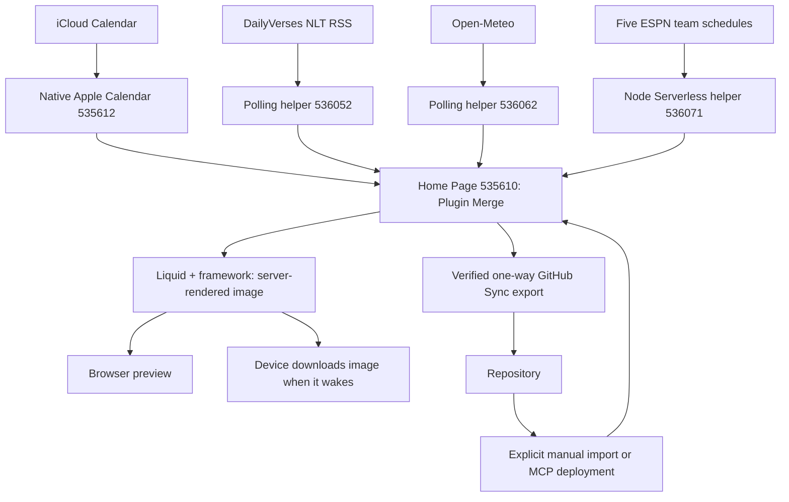

# Architecture

## Screen and device

The implemented screen is the private plugin **Home Page** (`535610`); its heading
is **Alvey Command Center**. It uses `plugin_merge`, framework **3.4.6** pinned,
light mode, normal screen padding, and a 15-minute refresh setting.

The account's device record is `75111`, model `v2` (TRMNL X), landscape, with
a 900-second wake interval. Render context reports 4-bit grayscale and time zone
`America/Indiana/Indianapolis`. The
[TRMNL X model](https://help.trmnl.com/en/articles/17434702-trmnl-x) lays out at
1040 × 780 and scales to a 1872 × 1404 panel.
At the audit, device width/height, firmware, and hardware check-in fields were
unset; the account record is not evidence that a physical unit has displayed
the latest screen.

## Data flow

## Live integrations and repository ownership

| Plugin setting | Responsibility | Configured refresh | Repository definition |
| --- | --- | --- | --- |
| `535610` Home Page | Seven-day combined display | 15 min | [src/settings.yml](../src/settings.yml), [full.liquid](../src/full.liquid), [shared.liquid](../src/shared.liquid) |
| `535612` Stu's iCal | Native Apple Calendar connection and parsed events | 30 min | Connection/credentials remain in TRMNL; no calendar payload is stored here |
| `536052` Daily Bible Verse — Data | First item of DailyVerses NLT RSS | 1440 min | [settings](../data-sources/daily-bible-verse/settings.yml) |
| `536062` Noblesville Weather — Data | Open-Meteo current weather and 14 forecast days | 60 min | [settings](../data-sources/noblesville-weather/settings.yml) |
| `536071` Indiana Sports — Data | Compact five ESPN schedules into seven local days | 60 min | [settings](../data-sources/indiana-sports/settings.yml), [transform](../data-sources/indiana-sports/transform.js) |

The three helper entries are hidden in the device playlist. They supply data
rather than separate core screens. Native Apple Calendar and Home Page are
visible. A Welcome screen and an unconfigured BTC recipe playlist entry also
exist in the account; they are not implemented Command Center features and
were left untouched.

The native calendar uses the `app_password` provider, an app-specific password
managed in TRMNL, 12-hour time, and the Noblesville time zone. Its current native
layout is `default` and `include_past_events` is `no`. Do not copy its credentials
or selected-calendar identifiers into this public repository.

Helper manifests intentionally record selected settings, not complete account
exports. They do not constitute an automated multi-plugin deployment.

## Merge-variable contracts

Private helper data is nested beneath `merge_variables`; native calendar data
is exposed directly. The IDs below are account-specific dependencies, not
portable IDs for another account.

| Template alias | Actual namespace and fields |
| --- | --- |
| `calendar` | `apple_calendar_535612`; `events[]` includes `summary`, `start`, `start_full`, `end_full`, `all_day`, `status` |
| `daily_verse` | First `private_plugin_536052.merge_variables.rss.channel.item`; `title` is the reference and `description` is NLT text |
| `weather` | `private_plugin_536062.merge_variables`; `current.temperature_2m` and parallel `daily` arrays for dates, WMO codes, highs/lows, precipitation probability |
| `sports` | `private_plugin_536071.merge_variables`; `games[]` contains local `day`, `matchup`, `time_label`, `logo`, `state`; `status` is `ok`, `partial`, or `unavailable` |

The weather location is Noblesville city center (`40.0456,-86.0086`), with
Fahrenheit temperatures and daily precipitation probability including snow.
Open-Meteo attribution is shown in the footer.

Sports covers Pacers/NBA, Colts/NFL, Purdue football, Purdue men's basketball,
and Butler men's basketball. The Node `run(input)` function fetches schedules
in parallel, applies Eastern time-zone/DST conversion, filters today through
day six, deduplicates league/event IDs, and labels TBD, postponed, cancelled,
live, and final states. It returns a small payload and source availability.
A small Pacers team-metadata polling request triggers the VM; full schedules
are fetched inside the VM to avoid the standard polling payload cap.

## Templates and refresh behavior

[full.liquid](../src/full.liquid) renders the heading/current temperature,
NLT verse, and daily Family/Games/Weather/Precipitation grid.
[shared.liquid](../src/shared.liquid) defines inline vector weather icons.
Other layout sizes and a Home Page transform are not implemented.

Calendar, games, and forecasts join by local date. Table overflow handling may
hide rows on a crowded display; event titles are clamped. Missing source data
is distinguished from a successfully fetched empty schedule.

Source fetching, screen rendering, and device waking are separate steps.
A 15-minute Home Page setting does not refetch every upstream source at that
rate, and a successful preview does not prove the device has downloaded it.
Hidden source plugins remain playlist dependencies for Plugin Merge refreshes.
See [TRMNL's data-mode guidance](https://docs.trmnl.com/go/private-api/plugin-data).

## Boundaries and limitations

- GitHub stores code, reviewed configuration, documentation, and public sports
  test fixtures. Personal calendar/health payloads and credentials stay out.
- Only Home Page's outbound GitHub Sync is verified. Helpers need explicit
  capture; GitHub-to-TRMNL deployment is manual. See [DEPLOYMENT.md](DEPLOYMENT.md).
- ESPN's public endpoints are an external dependency without a versioned
  contract here. Schedule changes become visible after a successful source fetch.
- NLT is tied to the NLT RSS URL; verify that source before changing the displayed
  translation label. Daily polling is not guaranteed to align with local midnight.
- Sports has fixture tests; there is no automated full-screen, source-availability,
  or physical-device test suite. Local preview lacks live merge fixtures.
- Oura connections appeared in the account during this audit; see
  [STATUS.md](STATUS.md). They are not referenced by Home Page yet. Today's
  Balance and separate Weather, Sports, Health, Markets/News detail screens are
  planned only and are not part of the current data flow.
