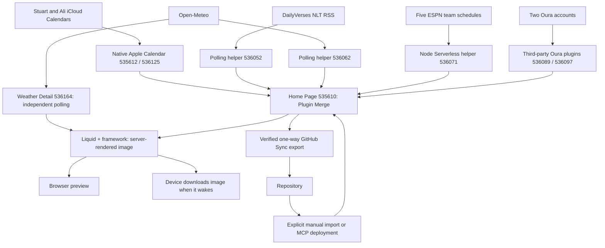

# Architecture

## Screen and device

The Home Page screen is the private plugin **Home Page** (`535610`); its heading
is **Alvey Command Center**. It uses `plugin_merge`, framework **3.4.6** pinned,
light mode, normal screen padding, and a 15-minute refresh setting.

The account's device record is `75111`, model `v2` (TRMNL X), landscape, with
a 900-second wake interval. Render context reports 4-bit grayscale and time zone
`America/Indiana/Indianapolis`. The
[TRMNL X model](https://help.trmnl.com/en/articles/17434702-trmnl-x) lays out at
1040 × 780 and scales to a 1872 × 1404 panel.
At the audit, device width/height, firmware, and hardware check-in fields were
unset; the account record is not evidence that a physical unit has displayed
the latest screen.

## Data flow

## Live integrations and repository ownership

| Plugin setting | Responsibility | Configured refresh | Repository definition |
| --- | --- | --- | --- |
| `535610` Home Page | Seven-day combined display | 15 min | [src/settings.yml](../src/settings.yml), [full.liquid](../src/full.liquid), [shared.liquid](../src/shared.liquid) |
| `535612` Stu's iCal / `536125` Ali's iCal | Two native Apple Calendar connections and parsed events | 30 min | Connection/credentials remain in TRMNL; no calendar payload is stored here |
| `536052` Daily Bible Verse — Data | First item of DailyVerses NLT RSS | 1440 min | [settings](../data-sources/daily-bible-verse/settings.yml) |
| `536062` Noblesville Weather — Data | Open-Meteo current weather and 14 forecast days | 60 min | [settings](../data-sources/noblesville-weather/settings.yml) |
| `536089` Stu's Oura / `536097` Ali's Oura | Account-specific rendered readiness snapshots | 60 min / provider default 60 min | Connections stay in TRMNL; adapter in shared.liquid |
| `536071` Indiana Sports — Data | Compact five ESPN schedules into seven local days | 60 min | [settings](../data-sources/indiana-sports/settings.yml), [transform](../data-sources/indiana-sports/transform.js) |

The three helper entries are hidden in the device playlist. They supply data
rather than separate core screens. The restored native Apple Calendar entries are hidden sources. Home, Weather,
Sports, and Health are the four visible core views; Welcome and Ali's Apple
Health also remain visible as configured by the owner. The former unconfigured
BTC playlist entry is absent and was not restored.

Both native calendars use the `app_password` provider, an app-specific password
managed in TRMNL, 12-hour time, and the Noblesville time zone. The inspected data uses the same local time zone. Do not copy its credentials
or selected-calendar identifiers into this public repository.

Helper manifests intentionally record selected settings, not complete account
exports. They do not constitute an automated multi-plugin deployment.

## Merge-variable contracts

Private helper data is nested beneath `merge_variables`; native calendar data
is exposed directly. The IDs below are account-specific dependencies, not
portable IDs for another account.

| Template alias | Actual namespace and fields |
| --- | --- |
| `stu_calendar` / `ali_calendar` | `apple_calendar_535612` / `apple_calendar_536125`; `events[]` includes `summary`, `start`, `start_full`, `end_full`, `all_day`, `status` |
| `daily_verse` | First `private_plugin_536052.merge_variables.rss.channel.item`; `title` is the reference and `description` is NLT text |
| `weather` | `private_plugin_536062.merge_variables`; `current.temperature_2m` and parallel `daily` arrays for dates, WMO codes, highs/lows, precipitation probability |
| `sports` | `private_plugin_536071.merge_variables`; `games[]` contains local `day`, `matchup`, `time_label`, `logo`, `state`; `status` is `ok`, `partial`, or `unavailable` |

The weather location is Noblesville city center (`40.0456,-86.0086`), with
Fahrenheit temperatures and daily precipitation probability including snow.
Open-Meteo attribution is shown in the footer.

Sports covers Pacers/NBA, Colts/NFL, Purdue football, Purdue men's basketball,
and Butler men's basketball. The Node `run(input)` function fetches schedules
in parallel, applies Eastern time-zone/DST conversion, filters today through
day six, deduplicates league/event IDs, and labels TBD, postponed, cancelled,
live, and final states. It returns a small payload and source availability.
A small Pacers team-metadata polling request triggers the VM; full schedules
are fetched inside the VM to avoid the standard polling payload cap.

## Templates and refresh behavior

[full.liquid](../src/full.liquid) renders the heading/current temperature,
NLT verse beside Today's Balance, and daily Family/Games/Weather/Precipitation grid.
[shared.liquid](../src/shared.liquid) defines inline vector weather icons and the readiness adapter/chart script.
Other layout sizes and a Home Page transform are not implemented.

Calendar, games, and forecasts join by local date. Table overflow handling may
hide rows on a crowded display; event titles are clamped. Missing source data
is distinguished from a successfully fetched empty schedule.

Source fetching, screen rendering, and device waking are separate steps.
A 15-minute Home Page setting does not refetch every upstream source at that
rate, and a successful preview does not prove the device has downloaded it.
Hidden source plugins remain playlist dependencies for Plugin Merge refreshes.
See [TRMNL's data-mode guidance](https://docs.trmnl.com/go/private-api/plugin-data).

## Boundaries and limitations

- GitHub stores code, reviewed configuration, documentation, and public sports
  test fixtures. Personal calendar/health payloads and credentials stay out.
- Only Home Page's outbound GitHub Sync is verified. Helpers need explicit
  capture; GitHub-to-TRMNL deployment is manual. See [DEPLOYMENT.md](DEPLOYMENT.md).
- ESPN's public endpoints are an external dependency without a versioned
  contract here. Schedule changes become visible after a successful source fetch.
- NLT is tied to the NLT RSS URL; verify that source before changing the displayed
  translation label. Daily polling is not guaranteed to align with local midnight.
- Sports has fixture tests; there is no automated full-screen, source-availability,
  or physical-device test suite. Local preview lacks live merge fixtures.
- A separate Markets/News detail screen remains planned.

## Today's Balance

Home consumes `oura_536089.markup_full` (Stuart) and `oura_536097.markup_full`
(Ali). This third-party plugin exposes rendered HTML, not structured readiness
metrics; its `merge_variables` object is empty. Templates escape each snapshot
into inert HTML template elements. The shared script extracts only a numeric
value immediately followed by the Readiness label, then updates text and SVG
before TRMNL captures the rendered image. No browser-side API request or device
JavaScript is required.

Stuart's share is rounded readiness / combined readiness × 100; Ali receives
the remainder, guaranteeing 100%. Both raw scores remain visible. Synthetic
90/80 yields 53/47. This is the owner's playful support-balance indicator, not
a medical recommendation or a measure of relationship obligations.

Only 0–100 scores with a same-local-day Last updated footer no older than six
hours (at most five minutes ahead) qualify. Missing, undated, stale, malformed,
or combined-zero inputs show a neutral ring and dashes rather than invented
percentages; individually fresh scores can still appear. The footer is snapshot
freshness, **not a verified readiness measurement date**. Upstream markup or
footer format changes can disable this adapter; inspect actual schemas before
repairing it. Synthetic unit tests live in [tests/balance.test.cjs](../tests/balance.test.cjs).

## Two-calendar merge

The full Liquid template concatenates both native event arrays, sorts by
`start_full`, and deduplicates each displayed day. With no event UID exposed,
a match requires trimmed, case-insensitive title and location, identical timed
start/end instants (epoch seconds), and the same all-day flag. All-day events
use local start/end dates. Missing title/start/end disables deduplication for
that record. Encoded, delimited keys prevent title/location delimiter collisions.
Cancelled entries neither render nor contribute ownership.

Small **S**, **A**, and **S+A** labels mean present in Stuart's calendar, Ali's
calendar, or both. They indicate source membership, not confirmed attendance.
Duplicates within a source also collapse. Different times, durations, locations,
or all-day status remain separate; minor title differences beyond case/outer
whitespace can leave intentional conservative duplicates. This only changes
Home Page presentation; it does not modify either iCloud calendar.

Existing all-day end-exclusive and multi-day rules remain. A missing source
shows an explicit calendar-unavailable notice while retaining the other feed;
empty healthy feeds show No events scheduled. Synthetic tests execute the actual
marked Liquid sections in [calendar.test.cjs](../tests/calendar.test.cjs).

Events whose source `calname` is `US Holidays` (case/outer-whitespace insensitive)
use **H**, overriding the personal source label. Holiday status comes from this
verified source name, never from words in the event title. Other holiday-feed
names require explicit mapping if added later.

## Weather Detail

**Weather Detail** `536164` is a separate full-screen landscape private plugin,
framework 3.4.6, light mode, normal padding, polling hourly. Visible playlist
item `901626` on device `75111` follows Home Page. Existing item order/visibility
is preserved. Its code lives in [views/weather/](../views/weather/), with no
Home Page or Plugin Merge dependencies. It calls Open-Meteo independently;
Home's existing hidden source `536062` is unchanged. This costs a second small
hourly forecast request and avoids changing a working integration.

Data flow: Open-Meteo → Weather Detail polling data → full/shared Liquid →
TRMNL rendered image → playlist/device. Current, hourly, and daily objects are
available directly at the template root. No transform, Node mode, API key, or
client-side JavaScript is needed. Units: °F, mph, inches; city-center coordinates
and `America/Indiana/Indianapolis` match Home. Settings record the exact query.

The primary visual is a seven-day high/low temperature curve with day icons,
point labels, and a separate shaded daily precipitation-probability band.
Inspired by [Weather Curve 500572](https://trmnl.com/recipes/500572); this is an
independent implementation using our existing Open-Meteo integration. Original
Liquid/SVG chart code uses horizontal cubic control points between adjacent
samples, keeping each segment between its endpoint values. Highs are hollow
black points; lows are filled gray points. A minimum 10°F temperature range
avoids division by zero and exaggerating flat forecasts. Missing values break
paths instead of connecting across gaps; percentages are not precipitation amounts.

Four compact cards show today's sunrise/sunset, **current-hour estimated UV**,
and the latest current wind/gusts/direction and relative humidity. UV comes from
`hourly.uv_index` for the local hour containing render time, never daily max UV
or a future hour. Missing current-hour UV is unavailable. UV categories use
<3 Low, <6 Moderate, <8 High, <11 Very high, otherwise Extreme. Wind directions
are eight compass sectors describing where the wind comes from. Current
conditions and feels-like appear in the header. Precipitation includes rain
and snow; this is not a radar/nowcast or weather-alert service.

The compact 24-hour precipitation summary remains: starting at the first local
hourly timestamp at or after render time, scan 24 samples for probability ≥40%.
Show its time, or a below-40% message only when all 24 probabilities exist.
Missing coverage reports timing unavailable. This is not an onset guarantee.
The former hourly checkpoint and daily tile sections were replaced by the
curve at the owner's request.

Local ISO timestamps are already provided by Open-Meteo. Render clock uses
TRMNL's user offset; daily lookup uses local dates rather than assuming index 0.
A current observation over three hours old or over one hour ahead shows a refresh
warning. Missing values show dashes/unavailable; zero values stay visible.
Local repeated/skipped hours around DST depend on upstream timestamp ordering;
this version does not disambiguate repeated local hours. Night-aware weather
icons are a view-local copy; root Home icons were deliberately left untouched.

Only full-screen is implemented. Weather Detail has **no verified GitHub Sync**;
its source/settings were manually captured. Do not import this view into root
Home Page. See [DEPLOYMENT.md](DEPLOYMENT.md).

## Sports Detail

**Sports Detail** `536256` is a standalone polling private plugin with a direct
GET-only ESPN transform, light mode, normal padding, framework 3.4.6, 15-minute
refresh. Visible playlist item `901764` follows Weather Detail. Files live in
[views/sports/](../views/sports/). Home's helper `536071` is untouched.

Data flow: small public Pacers metadata polling seed → `run(input)` fetches five
team schedules, PGA scoreboard, and two authenticated ESPN fantasy league reads
in parallel → sanitized compact JSON → full/shared Liquid → rendered image.
There is **no Sites app, proxy, hosted collector, or separate fantasy service**.

The five team cards show record, next/live game and latest final result. PGA
shows the returned current/latest tournament's first five leaderboard entries
in provider order, its state, and the next calendar event. It is explicitly a
snapshot, not streaming scores. Public ESPN payload fields were inspected live.

Fantasy APEX `244513322` / team `7` and NOB `35481112` / team `3` use season
2026, configurable in the form. Requests target only the ESPN fantasy host with
`mTeam`, `mMatchupScore`, and `mSettings`. Current team names are resolved from
responses; league/season/team presence is checked. Both authenticated responses
were verified after the owner entered the credentials. No personal values were
saved as fixtures or documentation.

Password fields: `espn_s2` / `espn_swid` for APEX; `nob_espn_s2` for NOB and
optional `nob_espn_swid`, which defaults to APEX's SWID when blank. **S2 never
falls back across leagues.** Secrets are read only inside the transform, sent
only as Cookie headers to the fixed ESPN fantasy host, never returned/logged.
Requests are GET-only, redirects are rejected, and public requests receive no
cookies. ESPN sessions themselves are not inherently read-only credentials.

Active matchups prefer verified `totalPointsLive` / `totalProjectedPointsLive`
fields; finalized results use `totalPoints` with a live fallback only if missing.
Null is distinct from zero. Current matchup and scoring period IDs plus league
matchup-period mappings determine phase. Previous results must be confirmed
completed; no result is inferred from the calendar or a partial score. Bye,
inactive, unknown period/schema, missing auth, access denied, and unavailable
sources have explicit states. Record and playoff seed come from API team data.
Projections are omitted when either is missing; they are not guaranteed outcomes.

Sources fail independently. There is no cross-refresh response cache in this
transform; a source failure renders unavailable instead of silently reusing old
data. Rendered snapshots older than 30 minutes show a refresh warning. Default
4.5-second fetch timeouts bound each request. Stat corrections can change results.

The live export currently leaves `serverless_language` blank while details
report `transform_runtime: serverless`; scheduled refresh jobs successfully run
async fetch. Do not require a Node switch solely from the blank export. The MCP
write-time transform preview returned an intermittent localhost connection error;
subsequent actual refresh jobs completed successfully. Verify refresh results,
not just the inline transform trial. Historical sports helper Node instructions
remain specific to that separate helper.

The manifest is intentionally partial and includes only form definitions, never
saved credential values. Automatic Sync is not configured/verified for this
plugin; capture only reviewed source and settings manually.

### Sports Detail standings, probabilities, and enclosure refinement

The subtitle/date/refresh status sit to the right of the title. PGA Tour and
Fantasy Football are equal-width enclosed section cards; PGA's leaderboard and
next tournament share one outer border, and both fantasy matchups share a named
outer card with nested league panels.

The collector additionally fetches four public ESPN group-standings endpoints
(one each for NBA, NFL, college football, and men's college basketball), shared
between tracked teams where applicable. It uses each matching group's first
`playoffSeed` statistic as the provider's conference position. This is explicitly
**not an overall league rank**. Pacers/Colts also show the division position from
schedule `standingSummary`; college cards show conference record instead of
inventing divisions. Standings lookup failure falls back to the existing summary
or an unavailable label without disabling schedule data. No rank is computed
from record order or guessed tiebreaks.

Active fantasy matchups show each side's ESPN `winProbability`, validated as a
finite fraction in [0,1] and converted to a percentage (one decimal maximum).
Zero is valid; missing/out-of-range probabilities hide the row. Both values
must be available; the other side is never inferred. Confirmed final/bye matchups
omit probabilities. These are provider estimates, not guaranteed results.

## Health Detail — first draft

**Health Detail** `536354` is full-screen Plugin Merge, framework 3.4.6,
light mode, normal padding, 15-minute render refresh. Playlist item
`901897` follows Sports Detail. Source is [views/health/](../views/health/).
Ali's separate Apple Health webhook was connected after the initial draft.

Data flow:

- Existing **Stu's Apple Health** `536212` webhook →
  `private_plugin_536212.merge_variables` → movement panel. The existing
  phone/export process is untouched. Its actual payload has metrics, trend
  summaries, and `daily_history[]` records with local `date` and `m.step_count`,
  `m.active_energy`, and `m.resting_heart_rate`. There are no hourly samples.
- Existing Oura `536089` / `536097` rendered markup → escaped inert templates →
  shared script parses numeric Readiness/Sleep/Activity labels → score gauges
  before server image capture. Reuses Home's strict same-day/six-hour footer
  freshness logic. Footer freshness is not proof of measurement date.
- Protein Social's existing public GET endpoint
  `https://proteinsocial.com/api/v1/public/workouts/stu` → new hourly polling
  helper **Workout Consistency — Data** `536353` → compact eight-week
  summaries → `private_plugin_536353.merge_variables` → heatmap and weekly bars.
  Helper playlist item `901896` stays hidden. No Site changes,
  credentials, login cookies, or new backend are needed. Standard User-Agent
  header was required for the public feed; default Python requests returned 403.

Movement shows today's record only when its local date matches today. Missing
step days render dashes, never zero bars. The displayed goal is configurable,
default **10,000**, shown as a dashed line. The solid-gray reference is the mean
of available prior-date records, not a same-hour baseline; prior snapshots may
not be finalized end-of-day totals. The feed currently has little stored history.
**No hourly curve or historical average-by-time is implemented or synthesized.**
Ali's Apple Health now shows a separate compact current-day summary alongside
Stuart's movement chart. Oura freshness remains independent of Apple Health.

The workout helper reads schema 1.0, requests local-date boundaries covering
eight Monday–Sunday columns (including this week), paginates at 50 records for
up to five pages, and deduplicates session IDs. It counts completed sessions
by local start date, excludes future/partial/invalid records, and sums only
known nonnegative durations. Multiple sessions can share a day; heatmap black
means at least one logged session. Gray means none logged within a complete
response, not no exercise. Outline means future/unknown. Pagination cap/failure
marks partial/unavailable rather than implying complete zero coverage. Weekly
bars count sessions, and current week is partial by calendar definition.

Only code, public endpoint configuration, and synthetic test data are captured
in GitHub. Runtime health payloads/screenshots remain private. Both new plugins
are manually captured; automatic Sync is not configured/verified. Existing
Home, Weather, Sports, Oura, and Apple Health definitions were not modified.

### Ali's raw Companion feed

Ali's Apple Health `536547` uses Webhook. Its actual input differs from Stuart's
already summarized feed: `health.metrics[]` supplies `metric_type`, `unit`,
`value`, `start_date`, and `end_date`; `health.workouts[]` and `reminders[]`
also arrived. The source initially passed raw data through; the size-limit repair below now normalizes its render output. Health Detail escapes only
the metric array as JSON in an inert template, then the shared script normalizes
current Indianapolis-day samples before the server captures the screen. Neither
reminders nor raw workout details are rendered or copied into the repository.

`appleSummary` accepts validated nonnegative numeric samples with valid start/end
and no end timestamp over five minutes ahead, buckets by local start date, and
removes exact duplicates by type/unit/start/end/value. Steps and active energy
are summed; kJ is converted to kcal, unknown energy units are ignored. Resting
heart rate uses the latest qualifying sample rather than a sum. Missing values
stay null/dashes. Ali's own latest contributing sample timestamp is displayed;
Stuart's separate source timestamp is explicitly named in the heading.

These are synced-sample totals, not a claim to reproduce Apple's cross-device
source-priority/deduplication algorithm. Nonidentical overlapping intervals are
not reconciled; intervals crossing midnight are assigned to their start day,
not apportioned. The schema now makes further intraday work possible, but no
hourly reference baseline or Ali historical chart is claimed by this update.
Oura remains separately timestamp-guarded, with Sync Oura for stale snapshots.

### Ali source payload reduction

With Serverless Node selected on `536547`, the new
[data-sources/ali-apple-health/transform.js](../data-sources/ali-apple-health/transform.js)
implements `run(input)`. It reduces the previously oversized raw export into
`health.metrics[]` daily records for seven local dates, keeping the same fields
that Health Detail's existing adapter consumes. Steps/energy are summed after
exact-duplicate filtering; kJ becomes kcal; the latest resting-HR sample per day
is retained. `health.step_hours[]` stores compact sums by local start-day/hour
for future intraday work. No hourly reference chart is introduced here.

Unknown metrics and reminder content are not included in render output. This
changes the plugin's processed variables; it does not delete phone Health data.
Intervals are assigned to their local start date; nonidentical overlapping
sources are still not reconciled using Apple's source-priority algorithm.
`normalization_version` plus explicit daily aggregation markers protect
idempotence without mistaking a fresh raw webhook upload for processed data.
Cached date formatters bound runtime/memory work. Synthetic tests assert a
3,500-sample output stays under 30 KB. Subsequent audit verified compact versioned output and healthy source state.
After any future change, validate the actual processed payload and source health;
if cached data continues to fail, obtain a fresh Companion upload.

## Playlist dependency inventory after audit

Device `75111` retains the four core views in order: Home `535610`, Weather
`536164`, Sports `536256`, Health `536354`. Source-only dependencies should be
**hidden**, not removed, so their refresh/playlist membership is retained.

| Consumer | Required sources retained on device |
| --- | --- |
| Home | Stuart calendar `535612`, Ali calendar `536125`, verse `536052`, weather `536062`, sports `536071`, Oura `536089` / `536097` |
| Weather Detail | Standalone polling; no helper dependency |
| Sports Detail | Standalone direct ESPN polling; credentials remain in its form |
| Health Detail | Stuart Health `536212`, Ali Health `536547`, Oura `536089` / `536097`, workout helper `536353` |

Both calendar entries had been deleted and were restored hidden as items
`902150` / `902151`. Their Merge namespaces were
still present before restoration: absence from the playlist does not prove an
immediate namespace/data disappearance. This audit restores the dependencies
rather than relying on cached data or assuming complete loss. Ali's Health item
remains visible as configured by the owner; other source entries are hidden.
Welcome remains visible, while the removed unconfigured BTC entry stays absent.

The size-limit repair was verified during this audit: Ali's processed variables
contain `normalization_version: ali-health-v1`, compact metric/hour arrays, and
no reminder content. Source state is healthy and the error count cleared. This
confirms processing, not the physical phone's background sync cadence.

### Personalized step-goal pacing (2026-11-10)

The walking panel now uses a one-time normalized **hour-of-day** cumulative walking profile derived from Apple Health's server-aggregated, de-duplicated hourly `stepCount` totals for **31 complete Indianapolis-local days, 2026-10-10 through 2026-11-09**. Percentages at the end of each hour are averaged across days, then scaled to the configurable step goal. Only the 25 normalized pacing fractions are kept in `views/health/full.liquid`; raw personal hourly data remains out of GitHub. Today's current `step_count` is shown as a point at the current local clock time; the curve represents *personalized goal pace*, not observed intraday steps or an hourly average steps line. The dotted horizontal line is the daily goal. The point is the latest synced daily total, which may lag render time. Refreshing the calibration later requires re-running the analysis, not just a webhook refresh.
