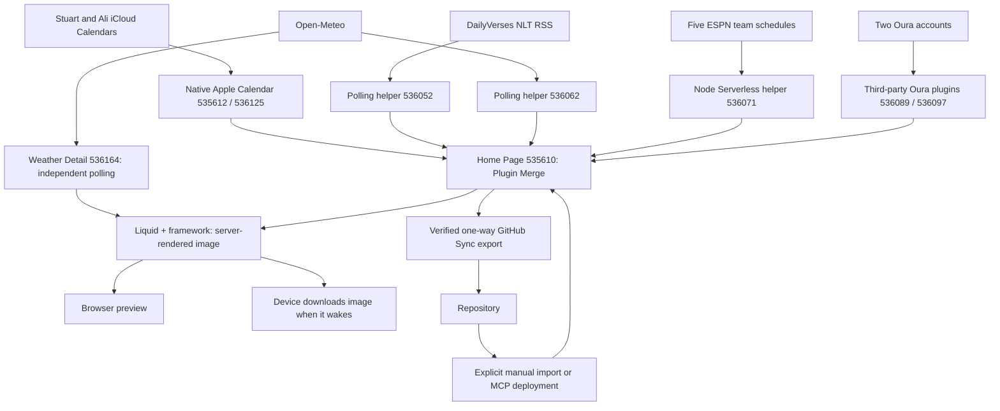

# Architecture

## Screen and device

The Home Page screen is the private plugin **Home Page** (`535610`); its heading
is **Alvey Command Center**. It uses `plugin_merge`, framework **3.4.6** pinned,
light mode, normal screen padding, and a 15-minute refresh setting.

The account's device record is `75111`, model `v2` (TRMNL X), landscape, with
a 900-second wake interval. Render context reports 4-bit grayscale and time zone
`America/Indiana/Indianapolis`. The
[TRMNL X model](https://help.trmnl.com/en/articles/17434702-trmnl-x) lays out at
1040 × 780 and scales to a 1872 × 1404 panel.
At the audit, device width/height, firmware, and hardware check-in fields were
unset; the account record is not evidence that a physical unit has displayed
the latest screen.

## Data flow

## Live integrations and repository ownership

| Plugin setting | Responsibility | Configured refresh | Repository definition |
| --- | --- | --- | --- |
| `535610` Home Page | Seven-day combined display | 15 min | [src/settings.yml](../src/settings.yml), [full.liquid](../src/full.liquid), [shared.liquid](../src/shared.liquid) |
| `535612` Stu's iCal / `536125` Ali's iCal | Two native Apple Calendar connections and parsed events | 30 min | Connection/credentials remain in TRMNL; no calendar payload is stored here |
| `536052` Daily Bible Verse — Data | First item of DailyVerses NLT RSS | 1440 min | [settings](../data-sources/daily-bible-verse/settings.yml) |
| `536062` Noblesville Weather — Data | Open-Meteo current weather and 14 forecast days | 60 min | [settings](../data-sources/noblesville-weather/settings.yml) |
| `536089` Stu's Oura / `536097` Ali's Oura | Account-specific rendered readiness snapshots | 60 min / provider default 60 min | Connections stay in TRMNL; adapter in shared.liquid |
| `536071` Indiana Sports — Data | Compact five ESPN schedules into seven local days | 60 min | [settings](../data-sources/indiana-sports/settings.yml), [transform](../data-sources/indiana-sports/transform.js) |

The three helper entries are hidden in the device playlist. They supply data
rather than separate core screens. Native Apple Calendars and Home Page are
visible. A Welcome screen and an unconfigured BTC recipe playlist entry also
exist in the account; they are not implemented Command Center features and
were left untouched.

Both native calendars use the `app_password` provider, an app-specific password
managed in TRMNL, 12-hour time, and the Noblesville time zone. The inspected data uses the same local time zone. Do not copy its credentials
or selected-calendar identifiers into this public repository.

Helper manifests intentionally record selected settings, not complete account
exports. They do not constitute an automated multi-plugin deployment.

## Merge-variable contracts

Private helper data is nested beneath `merge_variables`; native calendar data
is exposed directly. The IDs below are account-specific dependencies, not
portable IDs for another account.

| Template alias | Actual namespace and fields |
| --- | --- |
| `stu_calendar` / `ali_calendar` | `apple_calendar_535612` / `apple_calendar_536125`; `events[]` includes `summary`, `start`, `start_full`, `end_full`, `all_day`, `status` |
| `daily_verse` | First `private_plugin_536052.merge_variables.rss.channel.item`; `title` is the reference and `description` is NLT text |
| `weather` | `private_plugin_536062.merge_variables`; `current.temperature_2m` and parallel `daily` arrays for dates, WMO codes, highs/lows, precipitation probability |
| `sports` | `private_plugin_536071.merge_variables`; `games[]` contains local `day`, `matchup`, `time_label`, `logo`, `state`; `status` is `ok`, `partial`, or `unavailable` |

The weather location is Noblesville city center (`40.0456,-86.0086`), with
Fahrenheit temperatures and daily precipitation probability including snow.
Open-Meteo attribution is shown in the footer.

Sports covers Pacers/NBA, Colts/NFL, Purdue football, Purdue men's basketball,
and Butler men's basketball. The Node `run(input)` function fetches schedules
in parallel, applies Eastern time-zone/DST conversion, filters today through
day six, deduplicates league/event IDs, and labels TBD, postponed, cancelled,
live, and final states. It returns a small payload and source availability.
A small Pacers team-metadata polling request triggers the VM; full schedules
are fetched inside the VM to avoid the standard polling payload cap.

## Templates and refresh behavior

[full.liquid](../src/full.liquid) renders the heading/current temperature,
NLT verse beside Today's Balance, and daily Family/Games/Weather/Precipitation grid.
[shared.liquid](../src/shared.liquid) defines inline vector weather icons and the readiness adapter/chart script.
Other layout sizes and a Home Page transform are not implemented.

Calendar, games, and forecasts join by local date. Table overflow handling may
hide rows on a crowded display; event titles are clamped. Missing source data
is distinguished from a successfully fetched empty schedule.

Source fetching, screen rendering, and device waking are separate steps.
A 15-minute Home Page setting does not refetch every upstream source at that
rate, and a successful preview does not prove the device has downloaded it.
Hidden source plugins remain playlist dependencies for Plugin Merge refreshes.
See [TRMNL's data-mode guidance](https://docs.trmnl.com/go/private-api/plugin-data).

## Boundaries and limitations

- GitHub stores code, reviewed configuration, documentation, and public sports
  test fixtures. Personal calendar/health payloads and credentials stay out.
- Only Home Page's outbound GitHub Sync is verified. Helpers need explicit
  capture; GitHub-to-TRMNL deployment is manual. See [DEPLOYMENT.md](DEPLOYMENT.md).
- ESPN's public endpoints are an external dependency without a versioned
  contract here. Schedule changes become visible after a successful source fetch.
- NLT is tied to the NLT RSS URL; verify that source before changing the displayed
  translation label. Daily polling is not guaranteed to align with local midnight.
- Sports has fixture tests; there is no automated full-screen, source-availability,
  or physical-device test suite. Local preview lacks live merge fixtures.
- Separate Sports, Health, and Markets/News detail screens remain planned.

## Today's Balance

Home consumes `oura_536089.markup_full` (Stuart) and `oura_536097.markup_full`
(Ali). This third-party plugin exposes rendered HTML, not structured readiness
metrics; its `merge_variables` object is empty. Templates escape each snapshot
into inert HTML template elements. The shared script extracts only a numeric
value immediately followed by the Readiness label, then updates text and SVG
before TRMNL captures the rendered image. No browser-side API request or device
JavaScript is required.

Stuart's share is rounded readiness / combined readiness × 100; Ali receives
the remainder, guaranteeing 100%. Both raw scores remain visible. Synthetic
90/80 yields 53/47. This is the owner's playful support-balance indicator, not
a medical recommendation or a measure of relationship obligations.

Only 0–100 scores with a same-local-day Last updated footer no older than six
hours (at most five minutes ahead) qualify. Missing, undated, stale, malformed,
or combined-zero inputs show a neutral ring and dashes rather than invented
percentages; individually fresh scores can still appear. The footer is snapshot
freshness, **not a verified readiness measurement date**. Upstream markup or
footer format changes can disable this adapter; inspect actual schemas before
repairing it. Synthetic unit tests live in [tests/balance.test.cjs](../tests/balance.test.cjs).

## Two-calendar merge

The full Liquid template concatenates both native event arrays, sorts by
`start_full`, and deduplicates each displayed day. With no event UID exposed,
a match requires trimmed, case-insensitive title and location, identical timed
start/end instants (epoch seconds), and the same all-day flag. All-day events
use local start/end dates. Missing title/start/end disables deduplication for
that record. Encoded, delimited keys prevent title/location delimiter collisions.
Cancelled entries neither render nor contribute ownership.

Small **S**, **A**, and **S+A** labels mean present in Stuart's calendar, Ali's
calendar, or both. They indicate source membership, not confirmed attendance.
Duplicates within a source also collapse. Different times, durations, locations,
or all-day status remain separate; minor title differences beyond case/outer
whitespace can leave intentional conservative duplicates. This only changes
Home Page presentation; it does not modify either iCloud calendar.

Existing all-day end-exclusive and multi-day rules remain. A missing source
shows an explicit calendar-unavailable notice while retaining the other feed;
empty healthy feeds show No events scheduled. Synthetic tests execute the actual
marked Liquid sections in [calendar.test.cjs](../tests/calendar.test.cjs).

Events whose source `calname` is `US Holidays` (case/outer-whitespace insensitive)
use **H**, overriding the personal source label. Holiday status comes from this
verified source name, never from words in the event title. Other holiday-feed
names require explicit mapping if added later.

## Weather Detail

**Weather Detail** `536164` is a separate full-screen landscape private plugin,
framework 3.4.6, light mode, normal padding, polling hourly. Visible playlist
item `901626` on device `75111` follows Home Page. Existing item order/visibility
is preserved. Its code lives in [views/weather/](../views/weather/), with no
Home Page or Plugin Merge dependencies. It calls Open-Meteo independently;
Home's existing hidden source `536062` is unchanged. This costs a second small
hourly forecast request and avoids changing a working integration.

Data flow: Open-Meteo → Weather Detail polling data → full/shared Liquid →
TRMNL rendered image → playlist/device. Current, hourly, and daily objects are
available directly at the template root. No transform, Node mode, API key, or
client-side JavaScript is needed. Units: °F, mph, inches; city-center coordinates
and `America/Indiana/Indianapolis` match Home. Settings record the exact query.

The layout shows current conditions/feels-like/high/low; wind/gusts, humidity,
sunrise/sunset, and daily max UV; eight checkpoints every three forecast hours;
and seven daily forecasts. Hourly/current clear skies use moon icons at night.
Precipitation bars show probability, not quantity. Precipitation includes rain
and snow; this is not a radar/nowcast or weather-alert service.

Starting at the first local hourly timestamp at or after render time, scan the
next 24 samples for probability ≥40%. Display its time (Tomorrow when needed),
or Low chance ahead only when all 24 probabilities exist and remain below 40%.
Missing coverage reports Forecast incomplete. This threshold is a design choice,
not a promise that precipitation starts then. Eight display samples use offsets
0,3,…,21; they summarize, rather than display, every hour in the window.

Local ISO timestamps are already provided by Open-Meteo. Render clock uses
TRMNL's user offset; daily lookup uses local dates rather than assuming index 0.
A current observation over three hours old or over one hour ahead shows a refresh
warning. Missing values show dashes/unavailable; zero values stay visible.
Local repeated/skipped hours around DST depend on upstream timestamp ordering;
this version does not disambiguate repeated local hours. Night-aware weather
icons are a view-local copy; root Home icons were deliberately left untouched.

Only full-screen is implemented. Weather Detail has **no verified GitHub Sync**;
its source/settings were manually captured. Do not import this view into root
Home Page. See [DEPLOYMENT.md](DEPLOYMENT.md).
